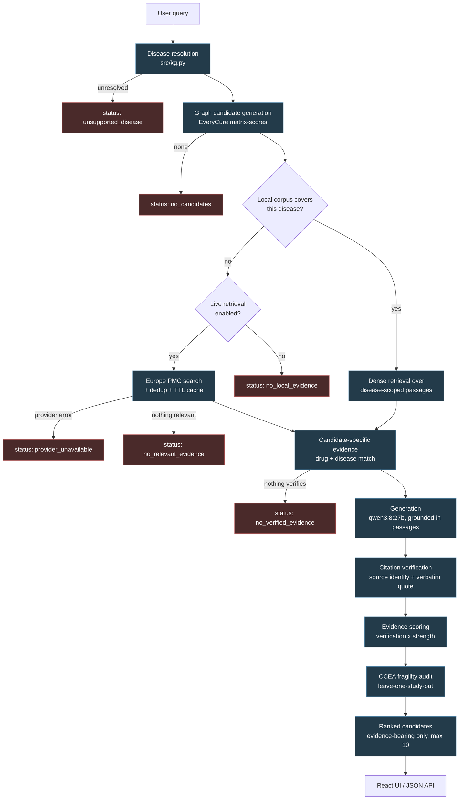

# PharmaSure

**Evidence-aware drug-repurposing candidate prioritisation for TELEMEDICON 2026.**

PharmaSure takes a disease name, resolves it to a canonical identifier, asks the
EveryCure knowledge graph which drugs are linked to it, retrieves biomedical
literature for those specific drug–disease pairs, verifies that quoted evidence
actually exists in the retrieved sources, and returns a ranked candidate list with
per-candidate evidence, citations, and a sensitivity audit.

> **PharmaSure is a research-support and hypothesis-generation tool. It is not a
> clinical decision system, it does not provide medical advice, and nothing it
> outputs is proof of efficacy.** See [Responsible use](#responsible-use-and-limitations).

---

## Quick start

```bash
# 1. Backend — Python 3.12, plus a local Ollama server
python3.12 -m venv venv
venv/bin/pip install -r requirements.txt
venv/bin/python src/app.py  # serves API + UI on http://127.0.0.1:7860

# 2. Frontend (separate terminal) — Node 24
cd frontend
npm install
npm run dev                 # http://127.0.0.1:3000, proxies /api to :7860
```

Requires a running [Ollama](https://ollama.com) with `nomic-embed-text` (embeddings)
and `qwen3.8:27b` (generation). Without them the backend starts but queries fail.
Full details in [Prerequisites](#prerequisites) and [Running PharmaSure](#running-pharmasure).

---

## The problem

Knowing that a knowledge graph links a drug to a disease is not evidence that the
drug helps. Two failures follow from treating the link as the answer:

1. **The graph is not the literature.** A candidate can be graph-linked with high
   confidence while the literature about that specific drug–disease pair is sparse,
   contradictory, duplicated, or about a different relationship entirely.
2. **Retrieval is not evidence.** A real PMID does not make an off-topic abstract
   into support for a claim. Returning plausible passages without checking that they
   concern *this* drug and *this* disease is how a RAG system fabricates support
   while every citation it prints is real.

PharmaSure's response is to keep three things separate that are easy to conflate:
**graph coverage**, **literature coverage**, and **verified evidence**. The system
would rather abstain with a stated reason than pad a candidate list.

### What it does not do

- It does not prove efficacy, and scores are not probabilities of clinical success.
- It does not replace clinical trials or expert review.
- It does not claim ranking accuracy: **no labelled relevance set was supplied**, so
  no precision/recall/NDCG/MRR figure is reported anywhere in this project.
- It has not been compared against Gemini, TxGNN, Open Targets, or any other system.

---

## Features and implementation status

| Capability | Status | Notes |
|---|---|---|
| Disease resolution (free text → canonical ID) | Implemented, verified | `src/kg.py`; 23,224 diseases in the lookup |
| EveryCure graph candidate generation | Implemented, verified | 24,174 diseases, 564,525 candidate rows, max 25/disease |
| Local dense retrieval | Implemented, verified | Ollama `nomic-embed-text`, 768-dim, NumPy cosine |
| Candidate-specific evidence filtering | Implemented, verified | Evidence scoped to the resolved disease *and* the named drug |
| Two-stage citation verification | Implemented, verified | Source identity, then contiguous-verbatim quote check |
| Candidate evidence scoring | Implemented, verified | `verification × (0.35·R + 0.35·P + 0.30·Q)` |
| CCEA evidence-fragility audit | Implemented, verified | Leave-one-independent-study-out, audit v1.0 |
| Redundancy / conflict analysis | Implemented, verified | Study units grouped by PMID; direction labels are heuristics |
| Safety-vs-efficacy separation | Implemented, verified | Harm language recorded separately, never folded into "contradictory" |
| Europe PMC live retrieval | Implemented, verified | Optional, env-gated; bounded results, TTL cache, dedup |
| Explicit abstention statuses | Implemented, verified | 9 distinct statuses; see [API](#api-reference) |
| React evidence-explorer UI | Implemented, verified | React 19 + TypeScript + Vite |
| Legacy Gradio console | Implemented, verified | Mounted at `/gradio` |
| Offline benchmark harness | Implemented, **not** an accuracy evaluation | `scripts/benchmark.py`; diagnostics only, 0 labelled queries |
| RRF alternative ranking | Implemented, **benchmark-only** | `src/ranking.py`; **not** in the runtime query path |
| Labelled relevance set / accuracy metrics | **Not implemented** | No ground-truth labels exist in this repository |
| BM25 / lexical retrieval | **Not implemented** | Dense retrieval only |
| Cross-PMID study-independence linkage | **Not implemented** | Independence is reported as `unknown` |

---

## Architecture



### Stage responsibilities

- **Graph candidate generation** is deliberately separate from literature retrieval.
  A graph candidate is a hypothesis, not a finding. Graph availability never implies
  literature support.
- **Retrieval** is dense-only, and always scoped to the resolved disease. Passages
  tagged with other diseases are never used as disease-specific evidence.
- **Verification** is deterministic, not model-judged: the citation ID must exist and
  the passage must mention the drug (source identity), and the quote must be a
  contiguous verbatim excerpt after documented normalisation (claim support).
- **The audit** is deterministic leave-one-study-out. It re-scores each candidate with
  one contributing study unit removed and reports the resulting rank movement.

### Frontend / backend boundary

A single FastAPI process serves the JSON API, the built React UI, and a legacy Gradio
console. The React dev server proxies `/api` and `/gradio` to the backend.

`src/app.py` also contains an **optional reverse proxy**: when `BACKEND_API_URL` is set
(or `frontend/dist/config.json` names a `proxyTarget`), a deployment that serves only
the UI forwards `/api/*` to a backend running elsewhere. Loopback requests are never
proxied, so local calls and the test suite always exercise the code in-process. This is
how a public UI deployment can reach a GPU host running behind a tunnel.

---

## Technology stack

Versions below were read from the manifests and runtime on the development host.

**Backend / API**
- Python **3.12.3** (`python:3.12-slim` in the Dockerfile)
- FastAPI `>=0.115`, uvicorn `>=0.30`, Gradio `>=6.0` (legacy console at `/gradio`)
- NumPy `>=2.0`, httpx `>=0.28`, pandas `>=3.0`, datasets `>=5.0`
- DuckDB `>=1.0` — used only by `scripts/build_candidates.py` to build the candidate table
- pytest `>=8.0` for tests

**Retrieval, ranking, evidence processing**
- Embeddings: Ollama `nomic-embed-text`, **768-dim**, L2-normalised, cosine similarity
- Vector store: a NumPy `.npy` matrix — no external vector database
- Generation: Ollama `qwen3.8:27b` (17.7 GB), `think: false`, `temperature: 0`, JSON-constrained
- Scoring: `verification × (0.35·relevance + 0.35·support + 0.30·study_quality)`
- RRF: implemented in `src/ranking.py`, used **only** by the offline benchmark

**Frontend**
- React **19**, TypeScript, Vite, Tailwind CSS 4, `lucide-react` icons
- Built with Node **24** (`npm run build` = `tsc && vite build`)

**Data sources**
- EveryCure knowledge graph, `matrix-scores` — 24,174 diseases, 564,525 candidate rows
- PubMed abstracts — 842 passages across 113 diseases (840 indexed)
- Europe PMC REST — live retrieval, optional

**Deployment**
- Docker (`Dockerfile`, Python 3.12-slim + Node 20 for the frontend build)
- `render.yaml` for the UI container; backend runs on a GPU host published over a tunnel

---

## Repository structure

```
PharmaSure/
├── src/
│   ├── app.py              # FastAPI app: /api/health, /api/query, /config.json,
│   │                       #   static SPA, /gradio, optional /api reverse proxy
│   ├── pipeline.py         # End-to-end orchestration and cache handling
│   ├── kg.py               # Disease resolution + EveryCure candidate lookup
│   ├── embeddings.py       # Ollama embedding client (truncation + retry)
│   ├── retrieval.py        # Cosine retrieval, re-rank, evidence scoring
│   ├── llm.py              # Ollama generation client (JSON repair + retry)
│   ├── verify.py           # Two-stage citation verification
│   ├── audit.py            # CCEA: study units, direction, leave-one-out
│   ├── ranking.py          # RRF alternative (benchmark-only)
│   ├── coverage.py         # Coverage metadata, version constants, cache identity
│   └── live_retrieval.py   # Europe PMC client, dedup, TTL cache
├── frontend/
│   ├── src/App.tsx         # Application shell and state
│   ├── src/components/     # CandidateCard, CitationDrawer, EvidenceExplorer,
│   │                       #   EvidenceFragilityProfile, CoverageStatus,
│   │                       #   RankingBenchmarkPanel, KnownIndications, ...
│   ├── src/services/       # api.ts, evidence.ts
│   └── public/config.json  # Runtime apiBase / proxyTarget
├── data/
│   ├── pubmed_passages.json  # 842 PubMed abstracts, 113 diseases
│   ├── passages.json         # 840 indexed passages (metadata for the index)
│   ├── index.npy             # 840 x 768 embedding matrix
│   ├── candidates.json       # EveryCure candidates + known indications
│   ├── disease_lookup.json   # 23,224 diseases for resolution
│   ├── drug_lookup.json      # Drug identifiers -> names
│   └── demo_cache.json       # Precomputed results for 5 demo queries
├── scripts/
│   ├── build_corpus.py       # Fetch abstracts from PubMed
│   ├── rebuild_index.py      # Re-embed and rebuild index.npy
│   ├── build_candidates.py   # Build candidates.json from matrix-scores (DuckDB)
│   ├── create_demo_cache.py  # Rebuild the demo cache
│   ├── evaluate_audit.py     # Reproducible audit evaluation
│   └── benchmark.py          # Offline/live benchmark harness
├── tests/                    # 8 test modules; see Testing
├── docs/                     # Design notes, decision log, methodology
├── benchmark/                # Query set + recorded results
├── Dockerfile · render.yaml · requirements.txt
└── README.md
```

`frontend/dist/` is committed because the container serves it; `frontend/node_modules/`,
`venv/`, and `__pycache__/` are not.

---

## Prerequisites

| Requirement | Version | Why |
|---|---|---|
| Python | 3.12 | Backend runtime |
| Node.js | 24 (20 also works in Docker) | Frontend build and dev server |
| Ollama | any recent | Serves embeddings and generation locally |
| Disk | ~25 GB free | `qwen3.8:27b` is 17.7 GB; data assets ~22 MB |
| GPU (optional) | 20 GB VRAM | Fits `qwen3.8:27b`; CPU inference is very slow |
| Network | only for live retrieval | Local-corpus queries work fully offline |

Pull the two models before first run:

```bash
ollama pull nomic-embed-text
ollama pull qwen3.8:27b
```

---

## Installation

```bash
git clone <repository-url>
cd PharmaSure

# Backend
python3.12 -m venv venv
venv/bin/pip install -r requirements.txt

# Frontend
cd frontend && npm install && cd ..
```

### Data and model assets

`data/` ships with the repository (large files are force-included via `.gitignore`
negations), so a fresh clone is queryable without rebuilding. To regenerate:

```bash
venv/bin/python scripts/build_corpus.py      # re-fetch PubMed abstracts
venv/bin/python scripts/rebuild_index.py     # re-embed -> data/index.npy
venv/bin/python scripts/build_candidates.py --top-n 25   # rebuild candidates.json
venv/bin/python scripts/create_demo_cache.py # rebuild the 5-query demo cache
```

`build_candidates.py` spills to disk (DuckDB `temp_directory`, 2 GB memory limit)
because the window function over the full matrix does not fit in RAM.

---

## Configuration and environment variables

All variables are optional for local-corpus use. **Never commit `.env`** — it is
gitignored.

| Variable | Required | Default | Purpose |
|---|---|---|---|
| `BACKEND_API_URL` | No | *(empty)* | If set, this process proxies `/api/*` to that backend. Used when the UI and the model run on different hosts. |
| `PHARMASURE_LIVE_RETRIEVAL` | No | *(disabled)* | Enables Europe PMC live retrieval. |
| `PHARMASURE_LIVE_PROVIDER` | No | `europepmc` | Live literature provider. |
| `PHARMASURE_LIVE_TIMEOUT_S` | No | `10` | Per-request timeout. |
| `PHARMASURE_LIVE_MAX_RESULTS` | No | `25` | Bounded result count (hard cap 100). |
| `PHARMASURE_LIVE_CACHE_TTL_S` | No | `3600` | TTL for successful live responses. |
| `PHARMASURE_LIVE_USER_AGENT` | No | *(built-in)* | Overrides the outbound User-Agent for the provider. |
| `VITE_DEV_PROXY_TARGET` | No | `http://127.0.0.1:7860` | Dev-server proxy target. |

The repository's `.env` currently contains a `GEMINI_API_KEY` placeholder. Note that
**no module under `src/` reads `GEMINI_API_KEY`** — generation is served by local Ollama.
The variable is a leftover from an earlier design and is not required.

---

## Running PharmaSure

**Terminal 1 — backend** (API + built UI + Gradio):

```bash
venv/bin/python src/app.py
# http://127.0.0.1:7860         UI and API
# http://127.0.0.1:7860/gradio  legacy console
```

**Terminal 2 — frontend dev server** (hot reload; proxies `/api` to the backend):

```bash
cd frontend && npm run dev
# http://127.0.0.1:3000
```

**Health check:**

```bash
curl http://127.0.0.1:7860/api/health
```

**Production-style single process:** `npm run build` in `frontend/`, then run the
backend alone — it serves `frontend/dist/` and the API from one port.

**Offline mode:** with live retrieval unset (the default), queries for diseases outside
the 113-disease corpus abstain with `no_local_evidence` rather than reaching the network.

---

## API reference

### `GET /api/health`

Reports capability and coverage metadata. It distinguishes **knowledge-graph
vocabulary** from **local literature coverage** — conflating them overstates what the
system can evidence. A `200` here means the process is up; it does **not** mean every
disease is answerable (see `all_diseases_supported: false`).

```bash
curl http://127.0.0.1:7860/api/health
```

Representative response (values from this repository's data):

```json
{
  "status": "ok",
  "disease_count": 23224,
  "kg_disease_count": 23224,
  "kg_diseases_with_candidates": 22581,
  "graph_candidates_available": true,
  "corpus_size": 840,
  "local_abstract_count": 840,
  "local_literature_disease_count": 113,
  "local_unique_pmid_count": 840,
  "corpus_schema_version": "2026-10-corpus-v2",
  "all_diseases_supported": false,
  "live_retrieval_enabled": true,
  "live_retrieval_provider": "europepmc",
  "demo_supported_diseases": ["Alzheimer's disease", "..."],
  "data_sources": ["EveryCure Knowledge Graph (matrix-scores)", "PubMed Literature Abstracts"]
}
```

### `POST /api/query`

The main endpoint.

| Field | Type | Required |
|---|---|---|
| `query` | string | Yes — non-empty disease name |

```bash
curl -X POST http://127.0.0.1:7860/api/query \
  -H 'Content-Type: application/json' \
  -d '{"query": "Alzheimer disease"}'
```

Representative response (trimmed; the full object is large):

```json
{
  "status": "ok",
  "query": "Alzheimer disease",
  "message": "Answered from the indexed local corpus (13 passage(s) ...)",
  "disease": { "id": "MONDO:0004975", "name": "Alzheimer disease", "synonyms": ["..."] },
  "results": [
    {
      "rank": 1,
      "drug": "Galantamine",
      "kg_score": 0.9979,
      "direction": "Positive",
      "evidence": {
        "score": 0.747,
        "tier": "Strong",
        "support": 3,
        "best_study_type": "clinical_trial",
        "verification": 1.0,
        "breakdown": {
          "verification": 1.0, "verification_role": "multiplier",
          "verified_claims": 2, "total_claims": 2,
          "evidence_strength": 0.747,
          "relevance": 0.677, "relevance_weight": 0.35,
          "support": 0.6, "support_weight": 0.35,
          "study_quality": 1.0, "study_quality_weight": 0.3
        }
      },
      "evidence_summary": {
        "candidate_source": "everycure_knowledge_graph",
        "graph_rank": 1, "graph_score": 0.9979, "drug_id": "EC:00733",
        "evidence_status": "supported",
        "passage_count": 3, "distinct_pmid_count": 3,
        "pmids": ["18686744", "39498781", "42851720"],
        "verification": { "claims": 2, "verified": 2, "needs_review": 0 },
        "limitations": []
      },
      "literature_coverage": {
        "status": "available", "source_record_count": 3,
        "distinct_pmid_count": 3, "verification_status": "verified"
      },
      "evidence_audit": { "version": "1.0", "method": "leave_one_independent_study_out" },
      "claims": [
        {
          "text": "Galantamine is an approved drug for symptomatic relief in Alzheimer's disease.",
          "citation_ids": [8],
          "quote": "regulatory-approved pharmacological interventions, such as galantamine, for symptomatic relief",
          "verification_status": "verified",
          "verification_reason": "All citations verified"
        }
      ]
    }
  ],
  "candidate_pool": [ { "drug": "...", "graph_rank": 1, "graph_score": 0.99, "evidence_status": "no_evidence" } ],
  "known_indications": [ { "drug_name": "Xanomeline", "drug_id": "CHEBI:10056" } ],
  "passages": [ { "text": "...", "pmid": "42851720", "source_url": "https://pubmed.ncbi.nlm.nih.gov/42851720/", "id": 1 } ],
  "evidence_scope": "local_corpus",
  "coverage": { "disease_resolution_status": "resolved", "literature_status": "available", "source_mode": "local" },
  "timings_ms": { "resolve": 257, "generate": 33574, "total_ms": 33865 },
  "from_cache": true,
  "corpus_schema_version": "2026-10-corpus-v2",
  "scoring_function": "retrieval.evidence_score:Vx(0.35R+0.35P+0.30Q)",
  "ranking_method": "evidence_score_desc",
  "candidates_with_evidence": 3,
  "displayed_candidate_cap": 10,
  "candidates_over_display_cap": 0,
  "response_contract_version": "2026-10-response-v4"
}
```

**`status` values.** Each names a different reason for a thin or empty result. They are
deliberately not collapsed into one another.

| Status | Meaning |
|---|---|
| `ok` | Candidates with verified evidence were produced. |
| `unsupported_disease` | The name did not resolve to a known disease. |
| `no_candidates` | Resolved, but the graph proposes no candidates. |
| `no_local_evidence` | Graph has candidates; the local corpus has no abstracts; live retrieval is off. |
| `provider_unavailable` | No local literature, **and** the live provider could not be reached. A retrieval failure, not a negative finding. |
| `no_relevant_evidence` | The provider answered, but nothing named a graph candidate. |
| `no_verified_evidence` | Candidates exist, but none has evidence passing verification. Absence of verified evidence — not evidence of ineffectiveness. |
| `insufficient_evidence` | Index or data unavailable at startup. |
| `unavailable_for_cached_result` | Audit status on a cache entry that predates the audit. |

**Errors.** `400` for malformed JSON (`Invalid JSON payload`) or a missing/blank
`query` field (`The 'query' field is required`). `502` from the optional proxy when the
upstream backend is unreachable.

### `GET /config.json`

Runtime frontend configuration: `apiBase` (what the browser calls; empty = same-origin)
and `proxyTarget` (what this server proxies `/api/*` to). Served `Cache-Control: no-store`.

### Other routes

- `/gradio` — legacy Gradio console.
- `GET /{path}` — static SPA from `frontend/dist/`, with unknown paths falling back to
  `index.html`. Serving is confined to the build directory.

---

## Retrieval, ranking, and evidence methodology

### 1. Candidate generation (graph)

`src/kg.py` resolves the query to a canonical disease ID, then reads the precomputed
EveryCure candidate list. The pool is **not** capped in code: 25 candidates per disease
are materialised in `data/candidates.json` (`--top-n 25`). Only the *display* is capped.

### 2. Retrieval (dense, disease-scoped)

Passages are embedded with `nomic-embed-text` (768-dim, L2-normalised) and ranked by
cosine similarity. Retrieval is scoped to passages tagged with the resolved disease.
There is **no lexical/BM25 path** and **no hybrid fusion** at query time.

### 3. Candidate-specific evidence

A passage becomes evidence for a candidate only if it names that drug *and* belongs to
the resolved disease. This is the safeguard that stops an off-topic global-corpus
abstract from being presented as disease-specific evidence. Graph candidate availability
is tracked separately from literature availability.

### 4. Citation verification (deterministic)

Two independent checks, both in `src/verify.py`:

1. **Source identity** — the citation ID exists and the passage actually mentions the
   drug.
2. **Claim support** — the quoted text is a *contiguous verbatim* excerpt of the passage
   after documented normalisation (case, whitespace, quote characters).

Failing either marks the claim `needs_review`. **No verified citation means no claim.**

### 5. Scoring

```
evidence_strength = 0.35 × relevance + 0.35 × support + 0.30 × study_quality
score             = verification × evidence_strength
```

- **verification** — fraction of the candidate's claims that verified (0–1). It is a
  **multiplier**, not an additive term, so a candidate with no verified quotation scores
  zero regardless of how relevant its passages look, and verified candidates always
  outrank unverified ones.
- **relevance** — cosine similarity of the best-matching passages.
- **support** — passage count for this drug, saturating. Duplicate passages for one
  source are **not** independent evidence, and the term counts passages rather than
  distinct PMIDs — a known limitation.
- **study_quality** — best study type: `clinical_trial` 1.0, `cohort` 0.7,
  `preclinical` 0.4, `review` 0.3, `other` 0.3.

Tiers: `Strong` / `Moderate` / `Preliminary`.

**These are ordering signals, not probabilities.** A score of 0.747 is not a 74.7%
chance of clinical success.

### 6. Ranking and display

Candidates are ordered by `evidence_score_desc`. **Candidates with a zero evidence score
are not displayed at all** — a zero-score row has no verified quotation to show, so
listing it invites comparison on nothing. Truncation is reported, never silent:
`candidates_with_evidence`, `displayed_candidate_cap` (10), and
`candidates_over_display_cap`. Dropped candidates remain visible in `candidate_pool`
with their graph rank, so availability is not hidden.

### 7. CCEA evidence-fragility audit

For each candidate, `src/audit.py` groups contributing passages into **study units**
(by PMID), computes a separate **evidence rank**, and re-scores with one study unit
removed. It reports the score delta and how far the candidate moved.

The audit states its own limits: evidence rank is *not* the displayed rank; study
independence is `unknown` (the corpus carries no trial-registration or author linkage,
so distinct PMIDs are not assumed independent); direction labels are unvalidated
heuristics with the triggering sentence stored; safety signals are kept separate from
efficacy; and stability is not clinical validity.

### 8. RRF (benchmark-only)

`src/ranking.py` implements Reciprocal Rank Fusion (Cormack, Clarke & Büttcher 2009,
k=60). It is used **only** by `scripts/benchmark.py` to compare an alternative ordering
against the baseline. It is **not** in the runtime query path — `/api/query` always
reports `ranking_method: "evidence_score_desc"`.

### 9. Evaluation status

`benchmark/results/*.json` records runs over a 10-query set. The recorded summary states
`labelled_queries: 0` and `metrics_available: false`: with no ground-truth labels, only
unlabelled diagnostics are produced. **Ranking accuracy has not been established.**

---

## Responsible use and limitations

- **Not medical advice.** Research prioritisation only; a qualified professional must
  interpret anything here.
- **Absence of evidence ≠ evidence of ineffectiveness.** Several statuses mean "we could
  not evidence this", not "this does not work".
- **Graph coverage ≠ literature coverage.** 23,224 diseases resolve; only 113 have local
  literature. Most resolvable diseases cannot be evidenced from the local corpus.
- **Evidence counts are not independent-study counts.** The `support` term counts
  passages. Distinct PMIDs may report the same underlying study or cohort, and the
  corpus cannot detect that.
- **Direction labels are heuristics**, not expert adjudication. An unclassified source is
  not evidence of consistency.
- **Safety ≠ efficacy.** Harm signals are recorded separately and never merged into a
  contradictory-direction label.
- **Publication bias** is unaddressed: negative and null results are under-represented in
  the literature that any retrieval system can reach.
- **No labelled relevance set exists**, so no accuracy metric is claimed.
- **No external comparison** against Gemini, TxGNN, Open Targets, or any other system has
  been run. Do not infer superiority.
- **Local corpus is a snapshot** of 842 abstracts across 113 diseases, not a systematic
  review.
- **Third-party network calls:** only Europe PMC, and only when live retrieval is enabled.
  With it disabled (the default), queries stay on this machine. The optional UI proxy
  forwards `/api/*` to whichever backend `BACKEND_API_URL` names.

---

## Testing

```bash
venv/bin/python -m pytest tests/ -q                 # full suite
venv/bin/python -m pytest tests/test_audit.py -v    # audit algorithm
venv/bin/python scripts/evaluate_audit.py           # reproducible audit evaluation
cd frontend && npm run build                        # type-check + build
```

**Result on the development host (re-run while writing this document):**

```
250 passed in 361.60s
```

Test modules: `test_api_integration`, `test_audit`, `test_candidate_evidence`,
`test_contract_integration`, `test_coverage`, `test_live_pipeline`, `test_live_retrieval`,
`test_ranking`.

**What the tests do and do not prove.** The suite covers pipeline statuses, evidence
boundaries, cache identity, the scoring contract, verification, the audit algorithm, and
live-retrieval behaviour with **mocked providers** — it does not require network access.
Passing tests establish that the code behaves as specified. They establish **nothing**
about clinical validity or ranking accuracy, and no coverage percentage is claimed here.

---

## Troubleshooting

| Symptom | Cause and fix |
|---|---|
| `Connection refused` on embeddings or generation | Ollama is not running, or the model is not pulled. Start Ollama and `ollama pull nomic-embed-text` / `qwen3.8:27b`. |
| First query takes ~30–60 s | Expected: the model loads from disk. Cold loads dominate the first call. |
| `no_local_evidence` for a well-known disease | The disease is outside the 113-disease corpus. Enable live retrieval or accept the abstention. |
| `provider_unavailable` | Europe PMC was unreachable. This is a retrieval failure, not a negative result — retry or disable live retrieval. |
| Empty candidate list | Check the `status` field first: `no_verified_evidence` and `no_relevant_evidence` are different problems from `no_candidates`. |
| Frontend shows a network error | The dev server proxies `/api` to `127.0.0.1:7860`; confirm the backend is running, or set `VITE_DEV_PROXY_TARGET`. |
| Port already in use | Backend uses `7860`, the dev server `3000`. Stop the stale process or change the port. |
| Stale results after a code change | The demo cache is versioned by corpus, response contract, and scoring function. If you changed the scorer, bump `RESPONSE_CONTRACT_VERSION` in `src/coverage.py` or the old entry is still served. |
| `tsc` errors on build | Use Node 24; the frontend expects a modern toolchain. |

---

## Documentation

| File | Contents |
|---|---|
| `docs/EVIDENCE_AUDIT.md` | CCEA methodology and limitations |
| `docs/LIVE_RETRIEVAL.md` | Europe PMC integration design |
| `docs/RANKING_AND_BENCHMARK.md` | Ranking methods and benchmark harness |
| `docs/DATA_SCHEMA.md` | EveryCure data schema |
| `docs/FRONTEND_INTEGRATION.md` | Frontend/backend contract |
| `docs/STACK.md`, `docs/DECISIONS.md` | Stack design and decision log |
| `docs/EVALUATION_CRITERIA.md`, `docs/PRD.md`, `docs/PITCH_DECK.md` | Project framing |

---

## Credits and licensing

PharmaSure builds on external resources that it does not own:

- **EveryCure** knowledge graph (`matrix-scores`) — candidate and indication data.
- **PubMed** — abstract text and PMIDs.
- **Europe PMC** REST API — live retrieval.
- **Ollama** with **`nomic-embed-text`** and **Qwen** — embeddings and generation.
- FastAPI, React, Vite, Tailwind CSS, NumPy, DuckDB, and their dependencies.

Each carries its own licence and attribution terms; consult the upstream projects before
redistributing data or models.

**This repository contains no `LICENSE` file.** The licensing status of the project's own
code is therefore unverified and should be confirmed by the maintainers before any
redistribution or reuse — do not assume a licence.
